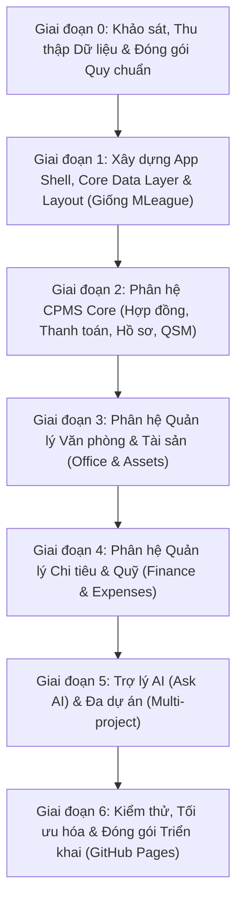

# MAIO Master Plan & Implementation Roadmap (Kế hoạch Tổng thể & Lộ trình)

Kế hoạch xây dựng hệ thống **MAIO (Multi-module All-in-One Management Portal)** chuyển đổi từ **CPMS Plus (Add-in Excel)** và mở rộng **Quản lý Văn phòng & Chi tiêu**:

---

## 1. Mục tiêu Chiến lược

1. **Chuyển đổi số toàn diện từ Excel lên Web:** Thay thế giao diện Add-in Excel cũ bằng giao diện Web hiện đại, mượt mà, truy cập được từ máy tính và thiết bị di động.
2. **Kế thừa 100% nghiệp vụ lõi của CPMS Plus:** Không làm mất mát hoặc sai lệch bất kỳ logic nào về Hợp đồng (A/B), phân cấp phụ lục, tính toán dòng tiền thanh toán (Payment Ledger), số hiệu hồ sơ (Document Tracker) và cảnh báo nhắc việc.
3. **Mở rộng hai phân hệ mới thiết yếu:**
   - Quản lý Văn phòng & Tài sản (Asset Management)
   - Quản lý Chi tiêu & Sổ quỹ ngân hàng (Finance & Expense Management)
4. **Trợ lý AI tích hợp (AI Assistant):** Tận dụng Gemini API để hỏi đáp trực tiếp trên dữ liệu hợp đồng, số dư quỹ và công nợ dự án.
5. **Tiêu chuẩn mở & Dễ tiếp tục cho mọi AI:** Lưu trữ toàn bộ quy tắc, schema và hướng dẫn để bất kỳ công cụ AI nào (Gemini, Claude, GPT, Cursor) cũng có thể tiếp quản và mở rộng dễ dàng.

---

## 2. Lộ trình Triển khai Chi tiết (Phased Roadmap)

### Chi tiết các Giai đoạn:

### Giai đoạn 0: Khảo sát, Đóng gói Dữ liệu & Quy chuẩn (ĐÃ HOÀN THÀNH)
- [x] Sao chép toàn bộ mã nguồn VBA (56 file), file Excel CPMS Plus mới nhất (`CPMS AR - Sign Date Sort Fix.xlsm` - 17/11/2026).
- [x] Sao chép dữ liệu export dự án thực tế mới nhất (`CHC1_20261118_103621.cpms`).
- [x] Thu thập các file mẫu Quản lý Văn phòng & Quỹ thu chi từ Moffice.
- [x] Phân tích schema chi tiết và tạo tài liệu `docs/DATA_SCHEMA.md`, `docs/ARCHITECTURE.md`.
- [x] Xây dựng Antigravity Skill và Rule hướng dẫn cho mọi AI.

### Giai đoạn 1: Xây dựng App Shell & Data Engine (Tương tự MLeague)
- [ ] Thiết lập khung giao diện chuẩn `index.html` với Typography `Inter`, icons `FontAwesome 6`, Navigation bar và Sidebar chuyển đổi giữa các module.
- [ ] Xây dựng hệ thống CSS đồng bộ (`css/main.css`, `css/components.css`).
- [ ] Xây dựng Data Adapter Core (`js/core/db.js`):
  - Local-first với `IndexedDB` để lưu trữ dữ liệu offline tốc độ cao.
  - Tích hợp công cụ Import trực tiếp từ file export `.cpms` hoặc `.xlsx`.
  - Cấu hình Firebase Authentication & Firestore sẵn sàng cho đồng bộ đám mây (`js/firebase-config.js`).

### Giai đoạn 2: Phát triển Phân hệ CPMS Core
- [ ] **Màn hình Danh mục Hợp đồng (`contracts.js`)**:
  - Hiển thị danh sách phân nhóm Nhóm A (Chủ đầu tư/Tổng thầu) và Nhóm B (Thầu phụ/NCC).
  - Cây hiển thị hợp đồng cha - con (phụ lục APP, gói thầu PKG).
  - Thêm, sửa, xem chi tiết hợp đồng, tìm kiếm và lọc linh hoạt.
- [ ] **Màn hình Sổ Thanh toán (`payments.js`)**:
  - Quản lý nhật ký từng đợt thanh toán, nghiệm thu, tạm ứng.
  - Tự động tính chênh lệch Đề nghị - Thực chi, theo dõi công nợ còn lại.
  - Hỗ trợ tỷ giá quy đổi tiền tệ.
- [ ] **Màn hình Quản lý Hồ sơ & Công văn (`documents.js`)**:
  - Quản lý theo dõi công văn, hồ sơ nghiệm thu, thanh toán.
  - Tạo số hiệu tự động theo định dạng chuẩn dự án.
- [ ] **Màn hình Cảnh báo & Nhắc việc (`reminders.js`)**:
  - Cảnh báo bảo lãnh hợp đồng sắp hết hạn, công nợ đến hạn thanh toán.

### Giai đoạn 3: Phát triển Phân hệ Quản lý Văn phòng & Tài sản
- [ ] Danh mục tài sản, thiết bị văn phòng, máy móc.
- [ ] Quản lý phân bổ/bàn giao tài sản cho cá nhân/phòng ban.
- [ ] Lịch sử kiểm kê, sửa chữa, bảo trì và thanh lý.
- [ ] Theo dõi nhu cầu & cấp phát văn phòng phẩm.

### Giai đoạn 4: Phát triển Phân hệ Quản lý Chi tiêu & Quỹ
- [ ] Quản lý sổ quỹ tiền mặt và tài khoản ngân hàng.
- [ ] Lập phiếu thu, phiếu chi, quản lý tạm ứng - hoàn ứng.
- [ ] Báo cáo tổng hợp thu chi, dòng tiền theo danh mục và theo dự án.

### Giai đoạn 5: Tích hợp Trợ lý AI & Quản trị Đa Dự án
- [ ] Chức năng chuyển đổi giữa các dự án (như cách đổi Project trong CPMS).
- [ ] Tích hợp Gemini API trong module Ask AI:
  - Tra cứu nhanh nội dung hợp đồng và công văn.
  - Đặt câu hỏi về số liệu thanh toán, công nợ, số dư quỹ.
- [ ] Phân quyền người dùng qua Firebase Auth.

### Giai đoạn 6: Kiểm thử, Tối ưu & Triển khai
- [ ] Kiểm thử toàn diện tính chính xác của các phép tính tài chính và đối chiếu với dữ liệu mẫu `CHC1_20261118_103621.cpms`.
- [ ] Tối ưu hóa giao diện responsive trên máy tính và điện thoại.
- [ ] Hướng dẫn triển khai lên GitHub Pages hoặc Firebase Hosting.
